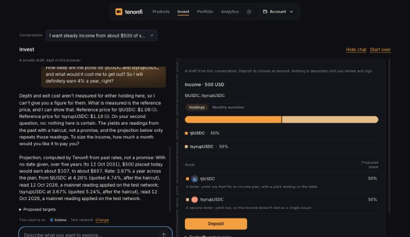
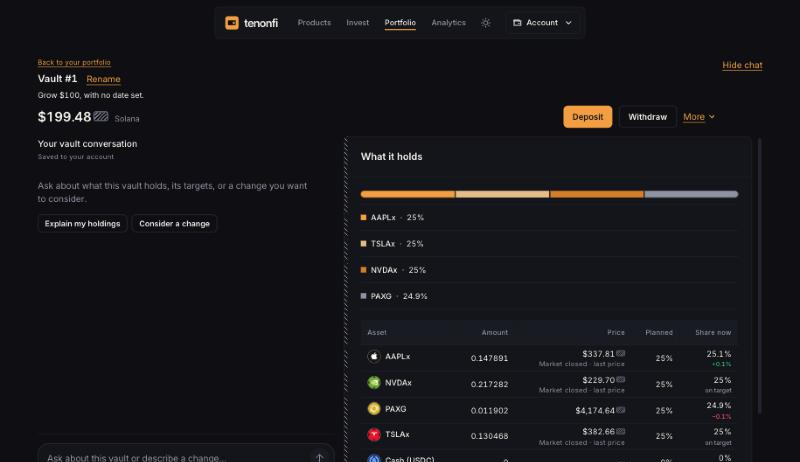
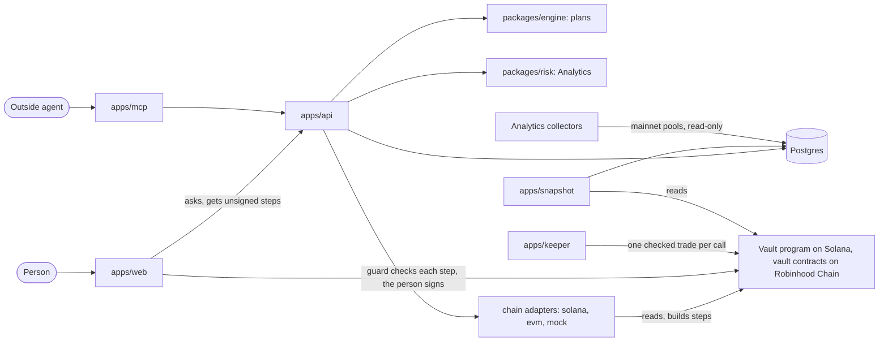

# Tenonfi

You tell Tenonfi, in a chat, what your money needs to do. It turns that goal into a plan made to measure and holds it in a vault you own, on one chain. Before you deposit, you see the exit plan: what getting out would cost at your size, and a withdrawal of the tokens themselves that needs nobody's permission.

It is for people who know what their money is for but don't want to build a portfolio by hand. It is also for the apps and agents that serve them.

We are Rodrigo Trindade and Thom Gabriel, and we built it for the Colosseum Crypto World's Fair (Sep 14 to Oct 12, 2026).

## How it works

You sign in with a passkey or your own wallet (through Privy), pick a chain and say your goal. A model talks it through and names holdings from that chain's catalog, but never sets a weight or types a number. The weights come from one function in code: an equal split, or the shares you stated. A measured figure the model refers to is written in by the server with its source, and the server checks every line again before you deposit.

The draft vault sits beside the chat, and you deposit from the same pane, signing each step. Your portfolio reads each vault from its chain and shows its drift from its targets, with a status of "On track", "Watch" or "Off track". To change a vault, ask in its own chat; nothing changes until you review and sign.

You can also follow a shared portfolio that someone publishes and updates. The registry on chain checks the author's limits. The vault program and contracts also support auto-follow, where our keeper rebalances a following vault one checked trade at a time. It has only run in a scripted check on Solana devnet, and the keeper is off on every hosted chain.

Analytics, our liquidity and risk layer (`bearing` in the code), measures what a sale costs at each size from pools on Solana mainnet and Robinhood Chain mainnet, read-only. The exit plan's numbers come from it (`packages/risk`, `scripts/risk-evm`, [`docs/risk/STATE-RISK.md`](docs/risk/STATE-RISK.md)).

Agents get an HTTP API with an OpenAPI document, an SDK, an MCP server with eight tools and a skill file ([`apps/mcp/README.md`](apps/mcp/README.md), [`skills/tenonfi/SKILL.md`](skills/tenonfi/SKILL.md)). An agent proposes; the person opens a link, reviews and signs.

A deterministic plan engine turns one goal into three candidate plans, each line with its reason. You can reach it three ways:

- `POST /v1/baskets/propose`, also the MCP tool `build_plan`
- `POST /v1/baskets/personalize`, which nothing in the app calls
- `pnpm plan:try`, the local playground

The chat on `/invest` does not use the engine to pick holdings.

The screens below are from Oct 12, a local run against the hosted API on Solana devnet: test-network reads, plus mainnet yields and exit costs applied to the stand-in tokens and labelled so.

| | |
|---|---|
|  |  |
| Say a goal; the draft vault sits beside the chat, and the sourced projection in it | The deposit is signed in the same pane, each step with its transaction |
|  |  |
| A vault read from its chain, against its targets | "all in Google" becomes a draft; nothing changes until it is reviewed and signed |

## Where it runs today

Robinhood Chain is on mainnet (chain id 4663). Thom deployed the vault contracts we serve on Oct 15, in 53 transactions, and the 2-of-2 Safe took the keys the same day. The app shows 19 tokens: NVDA, SPY, META, AAPL, TSLA, GOOGL, MSFT, AMZN, GLD, MSTR, CRCL, USO, PLTR, WETH, cbBTC, SPCX, COIN, TSM and BABA, each trading against USDG through its own Uniswap v4 pool. Six more are listed on chain and not shown yet: DELL, held back for its thin pool, and QQQ, MU, AMD, INTC and SLV, which trade through Uniswap v3 pools the app can't route yet. A shared portfolio can hold 1 to 16 assets, in steps of 0.5%, with the rest in cash, as your own vault can. Real money can be deposited. Before the deploy we rehearsed it whole on a copy of mainnet, and bought and sold back every token the app trades there ([`docs/vault/MAINNET-REDEPLOY.md`](docs/vault/MAINNET-REDEPLOY.md)). The first contracts, deployed on Oct 12, are still on chain and no longer served; their two vaults were emptied. The same contracts also run on the test network (chain id 46630), which the hosted app no longer serves. See [`deployments/robinhood-mainnet.json`](deployments/robinhood-mainnet.json) and [`deployments/robinhood-testnet.json`](deployments/robinhood-testnet.json).

Solana is on devnet, with 13 test tokens standing in for mainnet tokens, a test dollar and a test exchange we deployed ([`deployments/solana-devnet.json`](deployments/solana-devnet.json)). A deposit from the hosted app landed there and the trades after it were refused (order 771a1fad). Tests in LiteSVM and on a local validator in CI cover the fix and a plan's full run: trades, adding money and withdrawing in kind. A person's full run by hand is still to do. On devnet a shared portfolio was published and given a new version, and in a scripted check the keeper rebalanced a vault that follows one; tests on both chains cover the rest of shared portfolios.

Base is off: same Solidity contracts, nothing deployed.

One earlier run touched mainnet. On Sep 30 the first version of the engine ran on Solana from a demo wallet at small size: swaps, a lending deposit, and a rebalance signed by an agent key held on the server. We removed that server-signing route on Oct 13. Signatures are in [`docs/structurer/STATE.md`](docs/structurer/STATE.md), rows D2-AM to D6-PM.

Every task's evidence is in the ledger, [`docs/vault/STATE-VAULT.md`](docs/vault/STATE-VAULT.md), and every decision in [`docs/GATES.md`](docs/GATES.md). Where the ledger and the code disagree, the deployment records and the code are the source of truth.

## Which figures are real

Robinhood Chain figures are mainnet reads (`"provenance": "live"`) and carry no label. Solana figures are devnet reads labelled "test network" (`"provenance": "sandbox"`); a stand-in token borrows the measured exit depth and yield of the mainnet token it models, under the same label. Anything from the in-memory chain (`packages/chain-mock`, the local default) is labelled "Sample figures" (`"provenance": "mock"`).

## Safety

The API builds transactions and never signs for anyone. The guard in the browser (`packages/sdk`) reads each transaction's bytes and refuses anything that is not the step you approved. On chain, only the owner deposits or withdraws, and a keeper trade must stay inside the plan's assets, near a reference price and under a weekly loss limit. On Robinhood Chain mainnet, before it builds an owner's own trade, the app checks that the price is within 2% of a reference (Chainlink's feed while it is live, otherwise the pool's one-hour average, inside an outer rail) and that the size is under a cap per token; the contract does not check this (gate `OWNER-PRICE-BOUND`).

On Robinhood Chain the admin is a 2-of-2 Safe the two of us hold, directly, with no timelock for now: a change takes effect as soon as we both sign it. A 48-hour timelock comes back once the four first portfolios are published and have traded a week with the keeper off without an incident, and Thom says so (gate `ROBINHOOD-REDEPLOY`). A guardian can only pause; its address is also one of the Safe's owners. The keeper is off, there is no deposit cap, and the contracts are unaudited. [`docs/vault/SECURITY.md`](docs/vault/SECURITY.md) has who can do what, and how fast.

## Try it

The app is at <https://www.tenonfi.xyz> and the API at <https://tenonfi-api.onrender.com> (`/docs` for the OpenAPI pages, `/v1/config` for the chains and flags it runs with). The API sleeps when idle, so the first request can be slow. Sign in with a passkey, say a goal and choose the chain beside the box.

On Solana (devnet) everything is free: where the test faucet is configured, the deposit step offers "Get test funds" for the test dollars and gas. On Robinhood Chain (mainnet) a deposit is real money; your wallet needs its own USDG and ETH for gas, with no faucet. Read the notice before your first deposit: the contracts are unaudited.

To run it locally on the in-memory chain, with sample figures, you need Node 22 or later, pnpm 11 and Docker:

```sh
cp .env.example .env     # one file at the repo root serves every app and script
pnpm install
pnpm db:up               # Postgres 16 in Docker on port 5433, then the migrations
pnpm db:seed             # the asset registry rows
pnpm feeds:refresh       # yield and FX observations; the plan routes need them
pnpm feeds:refresh-models  # yields of the tokens the test networks' stand-ins model; after db:seed
pnpm dev                 # API on :3001 (/docs), web on :3000
```

The API won't start without the database. `.env.example` explains every variable; two matter most. Set `PRIVY_APP_ID` (commented out there) to the value of `NEXT_PUBLIC_PRIVY_APP_ID`, or the goal chat, orders and portfolio answer 503. Set `ANTHROPIC_API_KEY`, or only the guided intake works, reading goals with the rules parser alone and saying so.

The rest are described there too, such as `NEXT_PUBLIC_WALLET_DRIVER=test` (a throwaway browser wallet for screen work, without sign-in), `DATABASE_URL`, `SOLANA_RPC_URL`, and `CHAIN_MODE_<CHAIN>` and `CHAIN_NETWORK_<CHAIN>`: unset means the in-memory chain, and `testnet` when a chain is live, so nothing reaches mainnet by omission. To run against Solana devnet with a real passkey wallet, see [`docs/vault/RUN-DEVNET-LOCAL.md`](docs/vault/RUN-DEVNET-LOCAL.md).

## Architecture



| Folder | What is in it |
|---|---|
| `apps/` | `web` (Next.js), `api` (Fastify and zod, OpenAPI at `/docs`), `risk-api` (the `/risk/*` routes), `mcp` (the MCP server, which never signs), `keeper` (rebalances vaults with auto-follow on) and `snapshot` (reads every known vault every ten minutes; holds no key) |
| `packages/` | `engine` (the plan engine), `risk` (Analytics), `basket` (a plan's limits, drift and rebalance planner, free of any chain), `sdk` (the guard and the order executor), one `ChainAdapter` each in `chain-solana`, `chain-evm` and `chain-mock` (a chain in memory, stamped `mock`), `schemas` (shared zod types and the disclaimer) and `db` (Drizzle and Postgres) |
| `programs/`, `contracts/` | The Solana programs (Anchor, interfaces in `idl/`) and the EVM contracts (Foundry) |
| `deployments/` | What is deployed where, one file per network |
| `scripts/` | Checks, test-network operations and the collectors. `scripts/mainnet` is the live sender; a person runs it, never an agent |
| `spikes/`, `try/`, `content/`, `fixtures/` | The two early vault test rigs, the plan playground (`pnpm plan:try`), risk sheets and stock attributes, frozen test inputs |
| `docs/`, `.design/` | Specs, decisions and the ledger, indexed in [`docs/README.md`](docs/README.md); the design system |

The layout section of [`CLAUDE.md`](CLAUDE.md) has more on each folder. Who may import whom is a table in [`docs/vault/DESIGN-VAULT.md`](docs/vault/DESIGN-VAULT.md), section 2, and `tests/boundaries.test.ts` fails on anything else.

## Deployed addresses

Every address is from the files under `deployments/`.

Solana devnet:

| What | Address |
|---|---|
| Vault program | [`529j92ASeopFHuLLueGdyaUy4BsZ7UWqrgoVWn2iK1QW`](https://solscan.io/account/529j92ASeopFHuLLueGdyaUy4BsZ7UWqrgoVWn2iK1QW?cluster=devnet) |
| Test exchange and test prices (not part of the product) | [`2ticePjZZ6e34bNUgUXz7v3uHm3jS8jvV13gesdvKn4f`](https://solscan.io/account/2ticePjZZ6e34bNUgUXz7v3uHm3jS8jvV13gesdvKn4f?cluster=devnet) |
| Test dollar (tUSDC) | [`AEtFZt8Fq4PYzBs4d8VoMypDDhjp9XTv6qvhJZhd8BUn`](https://solscan.io/account/AEtFZt8Fq4PYzBs4d8VoMypDDhjp9XTv6qvhJZhd8BUn?cluster=devnet) |

Robinhood Chain mainnet (4663):

| What | Address |
|---|---|
| Vault factory | [`0x7e2bbb8483eb1baa6d87210bc83b63ad7a1bb8aa`](https://robin.etherscan.io/address/0x7e2bbb8483eb1baa6d87210bc83b63ad7a1bb8aa) |
| Shared-portfolio registry | [`0x65ff89c4436a11bb87e3c7328a3f02c407c7d6f8`](https://robin.etherscan.io/address/0x65ff89c4436a11bb87e3c7328a3f02c407c7d6f8) |
| Vault beacon | [`0x935658c738aef037092c69fd66b1ac3295882c0d`](https://robin.etherscan.io/address/0x935658c738aef037092c69fd66b1ac3295882c0d) |
| Safe, 2 of 2 (admin of the factory, owner of the beacon, at once: no timelock) | [`0x4568bc6cc821b34095059fd46102eaa22a675fdc`](https://robin.etherscan.io/address/0x4568bc6cc821b34095059fd46102eaa22a675fdc) |
| Guardian (can only pause; also one of the Safe's two owners) | [`0x0a1c3312c808b23d019bf241028f6b5624f4cc98`](https://robin.etherscan.io/address/0x0a1c3312c808b23d019bf241028f6b5624f4cc98) |
| USDG, the dollar token (not ours) | [`0x5fc5360d0400a0fd4f2af552add042d716f1d168`](https://robin.etherscan.io/address/0x5fc5360d0400a0fd4f2af552add042d716f1d168) |

These are the contracts of the redeploy of 2026-10-15 (gate `ROBINHOOD-REDEPLOY`): USDG and 25 tokens, the second shared-portfolio rules, held by the Safe directly with no timelock. Every transaction is in [`docs/vault/MAINNET-REDEPLOY.md`](docs/vault/MAINNET-REDEPLOY.md). The contracts of 2026-10-12, behind a timelock, are still deployed and no longer served ([`docs/vault/MAINNET-DEPLOY.md`](docs/vault/MAINNET-DEPLOY.md)).

Robinhood Chain test network (46630), still deployed and no longer served by the hosted app:

| What | Address |
|---|---|
| Vault factory | [`0xa3309dc51b41e55fcd48b12377025cd2ba4d21a4`](https://explorer.testnet.chain.robinhood.com/address/0xa3309dc51b41e55fcd48b12377025cd2ba4d21a4) |
| Shared-portfolio registry | [`0xe73c5df15452469873f610a26dac7fec68a23b14`](https://explorer.testnet.chain.robinhood.com/address/0xe73c5df15452469873f610a26dac7fec68a23b14) |
| Vault beacon | [`0x4c6699623966be46a40844da3e79d7da3d8d3d96`](https://explorer.testnet.chain.robinhood.com/address/0x4c6699623966be46a40844da3e79d7da3d8d3d96) |
| Test dollar (tUSDG) | [`0xd3d6e7bf284d922651983468b75492be4f3f689a`](https://explorer.testnet.chain.robinhood.com/address/0xd3d6e7bf284d922651983468b75492be4f3f689a) |

The tokens, the roles and the parameters are in the same files.

## How we test it

- `pnpm verify`: lint, both typechecks, the tests and the build. CI runs the same command on every pull request, against Postgres 16 (`.github/workflows/ci.yml`), and a second job runs the app in a browser with Playwright and axe.
- `pnpm test:program`: builds the Solana programs and runs their tests in LiteSVM. It needs Anchor and the Solana CLI ([`programs/README.md`](programs/README.md)). `program.yml` runs it when those files change, with the money path on a local validator.
- `pnpm test:contracts`: `forge test` in `contracts/`. It needs Foundry. `contracts.yml` runs it when those files change.
- `security.yml` runs gitleaks, `pnpm audit --prod` and cargo-deny on every pull request and weekly. The advisories we accept for now are in [`docs/vault/SECURITY-DEPS.md`](docs/vault/SECURITY-DEPS.md).

## Disclaimer

This tool is not licensed investment advice. It structures and explains an allocation from a goal you state; the decision and custody are yours. The distributor embedding this tool holds the client relationship.

## Team

Rodrigo Trindade built the plan engine, Analytics and the design system. Thom Gabriel built the vault program and contracts, the API and the app. Work that existed before the hackathon window is disclosed in [`docs/PRIOR-WORK.md`](docs/PRIOR-WORK.md). How work moves here, for people and for Claude sessions alike, is in [`CLAUDE.md`](CLAUDE.md).

## Licence

Apache-2.0. See [`LICENSE`](LICENSE).
